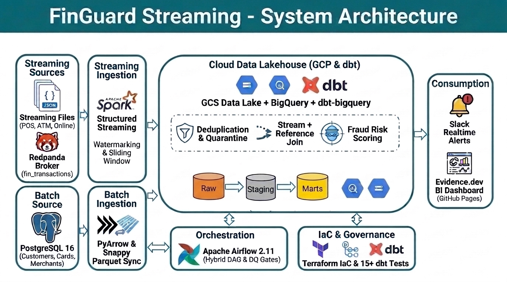
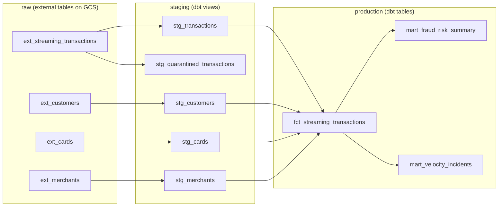
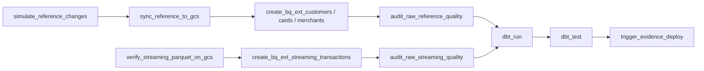

# FinGuard Streaming

**A real-time pipeline that watches card payments and spots fraud as it happens, built on Google Cloud.**

📊 **Live dashboard:** <https://tuanpmdev156.github.io/finguard-streaming/>


This is my final project for the [Data Engineering Zoomcamp](https://github.com/DataTalksClub/data-engineering-zoomcamp).

---

## 1. The problem

Every second, a bank sees many card payments: people buy things in shops (**POS**), take cash from machines (**ATM**), and pay on websites (**Online**). A small number of these payments are fraud.

The bank wants to:

1. **Catch fraud fast**, while it is happening, not the next day.
2. **Act on it automatically**, for example by blocking a stolen card.
3. **Look back at the history** to answer questions like:
   - What share of payments is fraud?
   - How much money is at risk?
   - Which channel, card brand, or country is the most risky?

This project builds a pipeline that does all three. It looks for four kinds of fraud:

| Fraud type | What it means | Simple example |
|---|---|---|
| **Velocity attack** | The same card is used many times in a very short time | 5 payments with one card in 1 minute |
| **High amount spike** | One payment is much bigger than normal | A $6,000 payment, or more than 90% of the card limit |
| **Geo mismatch** | A card is used in person in a country where the owner does not live | A card from Vietnam is used at an ATM in Germany |
| **Compromised card** | A blocked or expired card is used | A card that was reported stolen is still being used |

> All data is **fake** and is created by the project itself (with the Python library `Faker`). No real customer data is used.

---

## 2. Architecture



The pipeline has two paths that meet in BigQuery.

**Streaming path (every few seconds)**

1. A Python **producer** creates fake payments and sends them to **Redpanda** (a message queue that works like Kafka).
2. **Spark Structured Streaming** reads the payments, checks them against fraud rules, and adds a decision to each one (for example "freeze card").
3. If a card shows a velocity attack, Spark **blocks the card** in the PostgreSQL database right away.
4. Every 30 seconds, Spark saves the payments as **Parquet files** in **Google Cloud Storage (GCS)**.

**Batch path (every hour, run by Airflow)**

1. **PostgreSQL** holds the "reference" data: customers, cards, and merchants (shops).
2. **Airflow** copies these tables to GCS as Parquet files.
3. Airflow points **BigQuery** at the files in GCS, checks the data quality, and runs **dbt** to clean and join everything.
4. When dbt is done, Airflow starts a **GitHub Actions** job that rebuilds the **Evidence.dev dashboard**.

**Data layers in BigQuery**

We use three layers, from raw to ready-to-use:



- **raw**: the data exactly as it arrived.
- **staging**: cleaned data. Bad records are moved to a separate "quarantine" table.
- **production**: final tables that the dashboard reads.

**Where it runs**

Everything runs on Google Cloud, and Terraform creates all of it:

- One **Compute Engine VM** runs Redpanda, the producer, Spark, and Airflow in Docker containers.
- **Cloud SQL** runs PostgreSQL, so Google takes care of backups.
- **GCS** is the data lake and **BigQuery** is the data warehouse.
- The dashboard is a static website on **GitHub Pages**.

---

## 3. Tech stack

| Part | Tool | Why I used it |
|---|---|---|
| Cloud | Google Cloud (GCE, Cloud SQL, GCS, BigQuery, Secret Manager) | Managed services, generous free tier for BigQuery |
| Infrastructure as Code | Terraform | Create and delete all cloud resources with one command |
| Source database | PostgreSQL 16 | Holds customers, cards, and merchants, like a real bank system |
| Message queue | Redpanda | Works like Kafka, but is lighter and easier to run |
| Stream processing | PySpark Structured Streaming | Handles time windows and late data well |
| Orchestration | Apache Airflow 2.10 | Runs the hourly batch steps in the right order, with retries |
| Transformation | dbt (BigQuery) | SQL models with built-in tests |
| Dashboard | Evidence.dev | Dashboard written in Markdown + SQL, stored in Git |
| CI/CD | GitHub Actions | Rebuilds and publishes the dashboard automatically |
| Containers | Docker / Docker Compose | Same setup on my laptop and on the VM |
| Python packages | uv | Fast installs with a lock file |

---

## 4. How it works

### 4.1 Reference data (PostgreSQL)

- [`docker/postgres/init_tables.sql`](docker/postgres/init_tables.sql) creates three tables: `customers`, `cards`, and `merchants`.
- [`scripts/postgres_seed_data.py`](scripts/postgres_seed_data.py) fills them with fake data.
- [`scripts/postgres_incremental_load.py`](scripts/postgres_incremental_load.py) makes small changes every hour, like a real bank: new customers and cards, blocked cards, new credit limits. Airflow runs this step, so the data keeps changing over time.

### 4.2 Producer: fake payments

[`scripts/transaction_producer.py`](scripts/transaction_producer.py) sends about 2 payments per second to the Redpanda topic `fin_transactions`. Each payment is a small JSON message.

Most payments are normal. A few are fraud on purpose, so we can test the pipeline:

| Scenario | Share | How it is made |
|---|---|---|
| Normal | ~87% | Active card, shop in the owner's country, small amount |
| Velocity attack | ~3% | 4–6 payments on one card, sent 0.15 seconds apart |
| High amount spike | ~3% | Amount over $5,000 or over 90% of the card limit |
| Geo mismatch | ~3% | POS or ATM payment in a foreign country |
| Compromised card | ~3% | A blocked or expired card is used |
| Broken record | ~1% | Amount is 0 or negative (to test data cleaning) |

Each message uses `card_id` as its key, so all payments for one card go to the same Redpanda partition.

### 4.3 Spark streaming: catch fraud live

[`spark/streaming_consumer.py`](spark/streaming_consumer.py) runs two streams at the same time.

**Stream 1: velocity check with a sliding window**

- It looks at a **2-minute window** that moves forward every **30 seconds**.
- For each card, it counts the payments in the window. If there are **4 or more**, it raises a velocity alert.
- A **watermark of 2 minutes** tells Spark how long to wait for late messages before it closes a window.

**Stream 2: tag every payment and save it**

Every 30 seconds, Spark takes the new payments and gives each one a reason and a recommended action:

| Reason | Action | What the action means |
|---|---|---|
| `VELOCITY_ATTACK` | `AUTO_FREEZE_CARD` | Block the card now |
| `HIGH_AMOUNT_SPIKE` | `HOLD_FOR_STEP_UP_AUTH` | Hold the payment and ask the customer for an OTP |
| `GEO_MISMATCH` / `COMPROMISED_CARD` | `DECLINE_AND_CREATE_CASE` | Decline and open a case for the fraud team |
| `CORRUPT_AMOUNT` | `QUARANTINE_RECORD` | Keep the bad record aside |
| `CLEAN` | `APPROVE` | Normal payment |

**Closing the loop:** when the action is `AUTO_FREEZE_CARD`, Spark runs `UPDATE cards SET is_active = FALSE` in PostgreSQL. The card is blocked in the source system within seconds.

Spark writes each batch as a Snappy Parquet file to `gs://<bucket>/raw/streaming_transactions/`. It keeps **checkpoints** so that after a crash or restart it continues from where it stopped.

### 4.4 Airflow: the hourly batch job

The DAG [`airflow/dags/finguard_orchestrator.py`](airflow/dags/finguard_orchestrator.py) runs every hour.



| Step | Task | What it does |
|---|---|---|
| 0 | `simulate_reference_changes` | Makes small changes in PostgreSQL (new cards, blocked cards, and so on) |
| 1 | `sync_reference_to_gcs` | Copies `customers`, `cards`, `merchants` to GCS as Parquet |
| 2 | `verify_streaming_parquet_on_gcs` | Checks that Spark has written files to GCS |
| 3 | `create_bq_ext_*` | Creates or refreshes BigQuery external tables over the GCS files |
| 4 | `audit_raw_*_quality` | Quality gate: tables are not empty and key columns have no nulls |
| 5 | `dbt_run`, `dbt_test` | Builds the staging and production models, then runs tests |
| 6 | `trigger_evidence_deploy` | Calls the GitHub API to rebuild the dashboard |

If any step fails, the next steps do not run, so bad data never reaches the dashboard.

### 4.5 dbt: clean, join, and score

The dbt project is in [`dbt_finguard_streaming/`](dbt_finguard_streaming/).

**Staging (views)**

- `stg_transactions` cleans the payments and **removes duplicates**. Redpanda and Spark can deliver the same message twice ("at-least-once"), so we keep only the latest copy of each `transaction_id`.
- `stg_quarantined_transactions` collects bad records (missing keys, amount ≤ 0, wrong currency) with a `quarantine_reason`. They are kept for review and do not break the pipeline.
- `stg_customers`, `stg_cards`, `stg_merchants` clean the reference tables.

**Production (tables)**

- `fct_streaming_transactions` is the main table. It joins each payment with its customer, card, and merchant. It checks the four fraud rules again with the full reference data, then gives each payment:
  - a **risk score** from 0 to 100,
  - a **risk tier**: `LOW`, `MEDIUM`, `HIGH`, or `CRITICAL`,
  - an **`is_fraud`** flag (1 or 0).
- `mart_fraud_risk_summary` holds counts, fraud rate, and money at risk by date, hour, channel, card brand, country, and amount tier.
- `mart_velocity_incidents` lists every fraud payment, for the fraud team to review.

**Making BigQuery fast and cheap**

The production tables are **partitioned by `transaction_date`**, so a query for one day only reads that day's data. They are also **clustered**: `fct_streaming_transactions` by `transaction_channel`, `card_brand`, `is_fraud`. This makes the dashboard's filters cheaper and faster.

**Amount tiers** come from the macro `classify_amount`: `micro` (< $10), `low` ($10–50), `medium` ($50–200), `high` ($200–1,000), `critical` (≥ $1,000).

### 4.6 Dashboard and CI/CD

- The dashboard is written in Markdown + SQL in [`evidence/`](evidence/).
- The GitHub Actions workflow [`.github/workflows/deploy-evidence.yml`](.github/workflows/deploy-evidence.yml):
  1. pulls fresh data from the BigQuery production tables (`npm run sources`),
  2. builds a static website (`npm run build`),
  3. publishes it to GitHub Pages.
- It runs when Airflow calls it after a successful `dbt test`, when someone pushes changes to `evidence/`, or when started by hand.

---

## 5. Dashboard

**Link:** <https://tuanpmdev156.github.io/finguard-streaming/>

<!-- TODO: add a screenshot, e.g.  -->

The dashboard has four parts:

1. **Key numbers**: total payments, fraud rate, money at risk, the most risky channel, number of velocity attacks, and number of quarantined records.
2. **Over time**: payments and fraud by hour and by day.
3. **Risk breakdown**: fraud rate by channel, card brand, country, and amount tier, with summary tables.
4. **Audit tables**: the list of fraud payments with the action taken, and the list of quarantined records.

---

## 6. Data quality and reliability

| Problem | How the project handles it |
|---|---|
| The same message arrives twice | dbt keeps only one row per `transaction_id` |
| Broken records (amount ≤ 0, missing keys) | Moved to `stg_quarantined_transactions` with a reason, so the pipeline keeps running |
| Empty or broken source data | Airflow quality gates stop the run before dbt |
| Wrong results in the final tables | dbt tests: `unique`, `not_null`, `accepted_values`, `relationships`, plus two custom tests (amounts are positive; fraud rate is between 0 and 100) |
| A task fails for a short time (network error) | Airflow retries each task 2 times, 2 minutes apart |
| A task still fails after retries | Airflow sends a Slack message with the DAG, task, error, and a link to the log |
| Spark crashes or the VM restarts | Spark continues from its checkpoint. Containers restart by themselves |
| Running the DAG again | Each step replaces its output (files and tables), so a rerun does not create duplicates |

To test the Slack alert, set `SIMULATE_FAIL_TASK=<task_id>` (for example `sync_reference_to_gcs`) and run the DAG. That task will fail on purpose.

---

## 7. Cost and how to shut it down

Rough cost in `us-central1` if everything runs all day, every day:

| Resource | Size | About USD / month |
|---|---|---|
| VM | e2-standard-4, Spot | ~$30 (about $100 if not Spot) |
| VM disk | 50 GB | ~$5 |
| Cloud SQL | db-f1-micro + 10 GB | ~$9–12 |
| GCS + BigQuery | small data | ~$0–1 |
| **Total** | | **~$45–50** |

To save money, turn things on only when you need them:

```bash
# Stop / start the VM
gcloud compute instances stop finguard-vm --zone <zone>
gcloud compute instances start finguard-vm --zone <zone>

# Stop / start Cloud SQL
gcloud sql instances patch finguard-pg --activation-policy=NEVER
gcloud sql instances patch finguard-pg --activation-policy=ALWAYS
```

To delete everything:

```bash
terraform -chdir=terraform destroy
```

> ⚠️ `terraform destroy` also deletes Cloud SQL **and its backups**. Export the data first if you want to keep it.

---

## 8. Troubleshooting

Problems I hit while building this, and how I fixed them.

**Redpanda Console shows no new messages, but the producer is running**

You may be looking at a Console on your laptop, not the one on the VM. If Docker on your laptop already uses port `8081`, the SSH tunnel cannot use it. SSH only prints a short warning, so this is easy to miss. Forward to other local ports instead:

```bash
gcloud compute ssh finguard-vm --tunnel-through-iap -- -N -L 8085:localhost:8080 -L 8086:localhost:8081
# Airflow: http://localhost:8085   Redpanda Console: http://localhost:8086
```

You can also check on the VM directly. Run this twice; `HIGH-WATERMARK` should go up:

```bash
sudo docker exec finguard-redpanda rpk topic describe fin_transactions -p
```

The Console's *Messages* tab does not refresh by itself. Set the start offset to **Newest**.

**`dbt_run` fails with exit code 2 and no log**

The Airflow container runs as user `50000`, which cannot write to the repo folder on the VM. Fix the owner:

```bash
docker exec -u root finguard-airflow-scheduler chown -R 50000:0 /opt/airflow/dbt /opt/airflow/logs
```

To check the dbt setup, run:

```bash
docker exec finguard-airflow-scheduler dbt debug --project-dir /opt/airflow/dbt --profiles-dir /opt/airflow/dbt
```

**Airflow does not see a new value in `.env` (for example `GITHUB_TOKEN`)**

Restarting is not enough. Recreate the containers:

```bash
docker compose --env-file .env -f docker/docker-compose.cloud.yaml up -d --force-recreate airflow-webserver airflow-scheduler
```

**`trigger_evidence_deploy` fails with HTTP 401**

The GitHub token has expired. Create a new fine-grained token with **Actions: Read and write** on this repo, put it in `.env`, and recreate the Airflow containers as shown above.

---

## 9. Future work

- Add `chown -R 50000:0` to the VM startup script, so the dbt permission fix is not needed after a rebuild.
- Store the GitHub token in Secret Manager instead of pasting it into `.env`.
- Use Workload Identity Federation in GitHub Actions instead of a service account key.
- Add a GitHub Actions job that deploys code changes to the VM on every push to `main`.
- Send real-time Slack alerts from Spark for critical fraud events.
- Test that after a VM reboot, all containers come back and Spark continues from its checkpoint.

---

## 10. Acknowledgements

- [DataTalksClub Data Engineering Zoomcamp](https://github.com/DataTalksClub/data-engineering-zoomcamp), for the course and the project idea.
- [databeli/finguard_streaming_project](https://github.com/databeli/finguard_streaming_project), for the original FinGuard idea that inspired this project.
