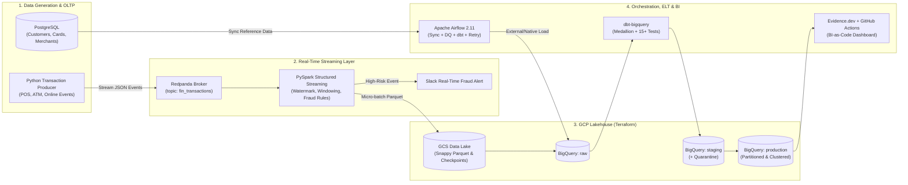

# FinGuard Streaming — Project Overview & Implementation Plan

## 1. Project Overview

* **Mục tiêu**: Xây dựng hệ thống **Real-Time & Near-Real-Time Financial Fraud Detection** lấy cảm hứng từ [`finguard_streaming_project`](https://github.com/databeli/finguard_streaming_project) (giám sát giao dịch `POS`, `ATM`, `Online` kết hợp dữ liệu tham chiếu khách hàng/thẻ/merchant trong PostgreSQL), được hiện đại hóa toàn diện bằng **Modern Data Stack** đồng bộ với dự án `fraud-risk-control-analytics`.
* **Bài toán nghiệp vụ giải quyết**:
  * **Real-Time Streaming Fraud Rules**: Phát hiện tức thời giao dịch vượt hạn mức (`High Amount`), tần suất quẹt thẻ liên tục trong thời gian ngắn (`Velocity Attack` qua Sliding Window & Watermarking), giao dịch lệch vị trí địa lý (`Geo/Location Anomaly`), và thẻ hết hạn/bị khóa (`Blocked/Expired Card`).
  * **Analytical Data Warehouse (Medallion Lakehouse)**: Phân tích lịch sử và quản trị rủi ro đa chiều gồm tỷ lệ gian lận (`Fraud Rate %`), tổn thất tài chính (`Fraud Exposure $`), phân bổ rủi ro theo kênh thanh toán (`POS`, `ATM`, `Online`), mạng lưới thẻ (`Visa`, `Mastercard`, `Amex`) và phân khúc mức tiền (`micro` đến `critical`).

---

## 2. Tech Stack

| Thành phần | Công nghệ lựa chọn | Chi tiết ứng dụng |
|---|---|---|
| **Cloud & Data Lakehouse** | Google Cloud Platform (GCP) | **GCS Data Lake** (Snappy Parquet + Spark Checkpoints) & **BigQuery Serverless DW** |
| **Infrastructure as Code** | Terraform | Tự động cấp phát GCS Bucket, BigQuery Datasets (`raw`, `staging`, `production`), IAM & Service Account |
| **Python Environment** | `uv` (Astral) | Quản lý dependencies và virtualenv tốc độ cao với lockfile (`pyproject.toml`, `uv.lock`) |
| **OLTP / Reference DB** | PostgreSQL 16 + PL/pgSQL (Docker) | Lưu trữ và sinh dữ liệu gốc (`customers`, `cards`, `merchants`) bằng PL/pgSQL & `Faker` |
| **Streaming Producer** | Python Direct Producer (`Faker` + `confluent-kafka`) | Giả lập Payment Gateway bắn trực tiếp JSON events (`POS`, `ATM`, `Online` + Fraud Rules) vào Redpanda |
| **Streaming Broker** | Redpanda + Console (Docker) | Event streaming platform tương thích 100% Kafka API, nhẹ, độ trễ thấp |
| **Stream Processing** | **PySpark Structured Streaming** | Đọc luồng từ Redpanda, áp dụng Watermarking & Sliding Window bắt lỗi Velocity, bắn Slack Alert và ghi Parquet xuống GCS |
| **Orchestration** | Apache Airflow 2.11 (Docker) | Điều phối đồng bộ Reference Data, BigQuery External Tables, Data Quality Gates, chạy `dbt` và gửi Slack Incident Alert |
| **Transformation & Testing** | `dbt-core` (`dbt-bigquery`) | Kiến trúc Medallion (`raw` ➔ `staging` ➔ `production`), deduplication, quarantine routing & 15+ automated tests |
| **BI-as-Code Dashboard** | Evidence.dev | Báo cáo phân tích bằng Markdown + SQL, quản lý phiên bản qua Git |
| **CI/CD** | GitHub Actions | Tự động kiểm tra chất lượng code/dữ liệu và build/deploy Evidence.dev lên GitHub Pages |

---

## 3. System Architecture



---

## 4. Cấu trúc Thư mục Dự án (`finguard-streaming/`)

```text
finguard-streaming/
├── .github/workflows/
│   └── deploy-evidence.yml          # CI/CD tự động build & deploy Evidence dashboard lên GitHub Pages
├── airflow/
│   ├── dags/
│   │   └── finguard_orchestrator.py # DAG điều phối Batch Reference Sync + Streaming Lakehouse ELT
│   ├── Dockerfile
│   └── docker-compose.yaml          # Cụm Airflow 2.11 (Webserver, Scheduler, Postgres metadata)
├── credentials/                     # Chứa GCP Service Account JSON key (git-ignored)
├── dbt_finguard_streaming/
│   ├── macros/                      # Custom macros (classify_amount, mask_card, ...)
│   ├── models/
│   │   ├── staging/                 # stg_transactions, stg_customers, stg_cards, stg_merchants, stg_quarantined_transactions
│   │   └── marts/                   # fct_streaming_transactions, mart_fraud_risk_summary, mart_velocity_incidents
│   ├── tests/                       # Singular business assertion tests
│   └── dbt_project.yml
├── docker/
│   ├── postgres/
│   │   └── init.sql                 # DDL & PL/pgSQL khởi tạo bảng customers, cards, merchants
│   └── docker-compose.streaming.yaml# Cụm Redpanda Broker, Redpanda Console (8081) & PostgreSQL OLTP
├── docs/                            # Tài liệu kiến trúc, EDA, hướng dẫn vận hành và ảnh chụp màn hình
├── evidence/                        # Dự án BI-as-Code (Evidence.dev)
├── notebooks/                       # Jupyter Notebooks khám phá dữ liệu & kiểm thử PySpark Streaming
├── plans/
│   └── overview.md                  # Tài liệu kế hoạch tổng thể và lộ trình thực thi theo từng Phase
├── scripts/
│   ├── seed_postgres.py             # Sinh dữ liệu gốc (Customers, Cards, Merchants) vào PostgreSQL
│   ├── sync_reference_to_gcs.py     # Trích xuất bảng từ PostgreSQL -> Snappy Parquet -> GCS
│   └── transaction_producer.py      # Bắn sự kiện giao dịch thời gian thực vào Redpanda (kèm kịch bản Fraud)
├── spark/
│   └── streaming_fraud_processor.py # Job PySpark Structured Streaming xử lý luồng, bắt lỗi Velocity & ghi GCS
├── terraform/                       # Khai báo hạ tầng GCP (GCS, BigQuery datasets, IAM)
├── pyproject.toml                   # Cấu hình dependencies quản lý bởi uv
└── README.md
```

---

## 5. Chi tiết Kế hoạch Thực thi theo từng Phase

### Phase 1: Khởi tạo Môi trường, Hạ tầng Cloud & Streaming Cluster
- [ ] **1.1. Thiết lập môi trường Python với `uv`**:
  - Khởi tạo `pyproject.toml` và `uv.lock` với các thư viện cốt lõi (`pyspark`, `confluent-kafka`, `pyarrow`, `psycopg2-binary`, `faker`, `google-cloud-storage`, `google-cloud-bigquery`, `dbt-bigquery`).
  - Thiết lập `.gitignore`, `.python-version`, và `.env.example`.
- [ ] **1.2. Cấp phát hạ tầng GCP bằng Terraform (`terraform/`)**:
  - Khởi tạo GCS Bucket làm Data Lake (`raw/reference/`, `raw/streaming_transactions/`, `checkpoints/`).
  - Khởi tạo 3 BigQuery Datasets theo chuẩn Medallion: `raw`, `staging`, `production`.
  - Tạo Service Account, gán quyền IAM (`Storage Admin`, `BigQuery Admin`) và xuất key về `credentials/pipeline-sa-key.json`.
- [ ] **1.3. Dựng cụm Streaming & OLTP bằng Docker (`docker/`)**:
  - Viết `docker/docker-compose.streaming.yaml` gồm: **Redpanda** (port `9092`/`19092`), **Redpanda Console** (port `8081`), và **PostgreSQL** (port `5432`).
  - Viết `docker/postgres/init.sql` (PL/pgSQL) tạo schema cho 3 bảng gốc: `customers`, `cards`, `merchants` kèm indexes và constraints.

---

### Phase 2: Reference Data Seeding & Real-Time Producer / PySpark Streaming
- [ ] **2.1. Khởi tạo & Đồng bộ Dữ liệu Tham chiếu (Reference Data)**:
  - Xây dựng `scripts/seed_postgres.py` dùng `Faker` sinh dữ liệu thực tế cho khách hàng (`customers`), thẻ tín dụng/ghi nợ (`cards` với hạn mức, trạng thái active/blocked) và điểm chấp nhận thanh toán (`merchants`).
  - Xây dựng `scripts/sync_reference_to_gcs.py` trích xuất dữ liệu từ PostgreSQL, kiểm tra schema bằng `PyArrow`, nén thành **Snappy Parquet** và tải lên `gs://<bucket>/raw/reference/`.
- [ ] **2.2. Xây dựng Real-Time Transaction Producer (`scripts/transaction_producer.py`)**:
  - Sinh giao dịch liên tục từ các kênh `POS`, `ATM`, `Online` và đẩy vào Redpanda topic `fin_transactions`.
  - Tích hợp bộ mô phỏng kịch bản gian lận (**Fraud Injection Scenarios**):
    - **Velocity Attack**: Cùng 1 `card_id` thực hiện >= 4 giao dịch chỉ trong 1–2 phút.
    - **High-Amount Spike**: Giao dịch vượt 90% hạn mức thẻ hoặc > `$5,000`.
    - **Geo/Country Mismatch**: Giao dịch vật lý (`POS`/`ATM`) tại quốc gia khác với địa chỉ đăng ký của khách hàng.
    - **Compromised/Inactive Card**: Giao dịch phát sinh trên thẻ đã hết hạn hoặc bị khóa (`is_active = false`).
- [ ] **2.3. Xây dựng PySpark Structured Streaming Engine (`spark/streaming_fraud_processor.py`)**:
  - Kết nối vào Redpanda topic `fin_transactions`, parse JSON payload với `StructType` chặt chẽ.
  - Áp dụng `withWatermark("transaction_timestamp", "2 minutes")` và `groupBy(window(...), col("card_id"))` để phát hiện **Velocity Fraud** ngay trên luồng.
  - Gắn cờ rủi ro (`stream_fraud_flag`, `stream_fraud_reason`) và bắn **Real-Time Slack Alert** đối với các giao dịch mức `CRITICAL`.
  - Ghi dữ liệu micro-batch (`trigger(processingTime="30 seconds")`) dưới định dạng **Snappy Parquet** xuống `gs://<bucket>/raw/streaming_transactions/` cùng cơ chế fault-tolerance qua `checkpointLocation`.

---

### Phase 3: Data Warehouse Modeling & Data Quality (`dbt-bigquery`)
- [ ] **3.1. Khởi tạo dự án `dbt_finguard_streaming`**:
  - Cấu hình `dbt_project.yml`, `profiles.yml` và các custom macros (`classify_amount`, chuẩn hóa tiền tệ/thời gian).
- [ ] **3.2. Xây dựng Tầng Staging & Quarantine (`models/staging/` — Views)**:
  - `stg_customers.sql`, `stg_cards.sql`, `stg_merchants.sql`: Chuẩn hóa kiểu dữ liệu và làm sạch bảng tham chiếu.
  - `stg_transactions.sql`: Làm sạch luồng giao dịch từ GCS/BigQuery `raw`, khử trùng lặp do cơ chế *at-least-once delivery* của Kafka/Redpanda bằng `QUALIFY ROW_NUMBER() OVER (PARTITION BY transaction_id ORDER BY ingested_at DESC) = 1`.
  - `stg_quarantined_transactions.sql`: Tự động tách và cô lập các bản ghi dị biệt (`amount <= 0`, thiếu `card_id`/`customer_id`, sai định dạng tiền tệ) kèm cột `quarantine_reason`.
- [ ] **3.3. Xây dựng Tầng Production Marts (`models/marts/` — Partitioned & Clustered Tables)**:
  - `fct_streaming_transactions.sql`: Bảng Fact trung tâm kết hợp giao dịch stream với thông tin `customers`, `cards`, `merchants`, tính toán tổng hợp điểm rủi ro (`risk_score`, `risk_tier`, `is_fraud`). Partition theo `transaction_date`, Cluster theo `transaction_channel`, `card_brand`, `is_fraud`.
  - `mart_fraud_risk_summary.sql`: Bảng tổng hợp KPIs rủi ro theo ngày/khung giờ, kênh giao dịch (`POS`, `ATM`, `Online`), loại thẻ và danh mục merchant (`MCC`).
  - `mart_velocity_incidents.sql`: Bảng chuyên biệt phục vụ điều tra các chuỗi giao dịch bất thường theo cửa sổ thời gian và thẻ bị xâm phạm.
- [ ] **3.4. Thiết lập Automated Data Quality Tests (`15+ Tests`)**:
  - **Generic Schema Tests**: `unique`, `not_null`, `accepted_values`, `relationships` trên toàn bộ khóa chính và cột phân loại.
  - **Singular Business Tests**:
    - `assert_positive_transaction_amounts.sql`: Đảm bảo không có giao dịch `<= 0` lọt vào bảng Fact.
    - `assert_valid_fraud_rate_bounds.sql`: Đảm bảo `fraud_rate` luôn nằm trong khoảng `[0, 100]%`.

---

### Phase 4: Hybrid Orchestration & Resilience Engineering (`Apache Airflow 2.11`)
- [ ] **4.1. Xây dựng Airflow DAG (`airflow/dags/finguard_orchestrator.py`)**:
  - Tự động hóa chuỗi tác vụ:
    1. Kiểm tra kết nối và đồng bộ Reference Data (`Postgres` ➔ `GCS Parquet`).
    2. Kiểm tra dữ liệu Parquet từ luồng **PySpark Streaming** trên GCS (`raw/streaming_transactions/`).
    3. Khởi tạo/Cập nhật các bảng **BigQuery External Tables** (`raw.ext_customers`, `raw.ext_cards`, `raw.ext_merchants`, `raw.ext_streaming_transactions`).
    4. Thực thi **Data Quality Audit Gates** tại tầng `raw` (kiểm tra row counts, schema integrity).
    5. Kích hoạt `dbt run` và `dbt test`.
    6. Bắn `workflow_dispatch` sang GitHub REST API để tự động cập nhật Dashboard.
- [ ] **4.2. Kiểm thử Độ bền & Mô phỏng Sự cố (Resilience Testing & Alerting)**:
  - **Job Interruption & Idempotency**: Kiểm chứng tính năng tự động `retry` và đảm bảo chạy lại DAG nhiều lần không gây nhân bản dữ liệu.
  - **Real-time Slack Failure Alerting**: Cấu hình `on_failure_callback` gửi thông báo chi tiết (DAG ID, Task ID, Execution Time, Log URL) vào Slack khi task thất bại.
  - **Schema Drift & Corrupt Payload Protection**: Mô phỏng bản ghi lỗi hoặc thiếu cột bắt buộc để kiểm chứng cơ chế Fail-fast và Quarantine Routing.

---

### Phase 5: BI-as-Code Dashboard (`Evidence.dev`) & CI/CD (`GitHub Actions`)
- [ ] **5.1. Xây dựng Dashboard Phân tích Rủi ro trên Evidence.dev (`evidence/`)**:
  - **Executive Scorecards**: Tổng số giao dịch stream, Tỷ lệ gian lận (`Fraud Rate %`), Tổng giá trị rủi ro (`Fraud Exposure $`), Kênh thanh toán rủi ro cao nhất.
  - **Temporal & Velocity Analytics**: Biểu đồ lưu lượng giao dịch và số vụ gian lận theo thời gian/khung giờ.
  - **Multi-Dimensional Risk Breakdown**: Phân tích gian lận theo kênh (`POS`, `ATM`, `Online`), thương hiệu thẻ (`Visa`, `Mastercard`, `Amex`), quốc gia và phân khúc giá trị giao dịch (`micro` ➔ `critical`).
  - **Quarantine & Incident Audit Table**: Bảng tra cứu trực tiếp các thẻ bị cảnh báo Velocity và các bản ghi bị cách ly.
- [ ] **5.2. Thiết lập CI/CD Pipeline (`.github/workflows/deploy-evidence.yml`)**:
  - Tự động xác thực GCP qua GitHub Secrets, trích xuất dữ liệu mới nhất từ BigQuery production marts (`npm run sources`), build static site (`npm run build`) và xuất bản lên **GitHub Pages**.
- [ ] **5.3. Hoàn thiện Tài liệu (`README.md` & `docs/`)**:
  - Viết hướng dẫn cài đặt & tái hiện dự án từng bước (Quick Start & Reproduction Guide), sơ đồ kiến trúc, kết quả benchmark và ảnh chụp/GIF minh họa toàn bộ luồng.

