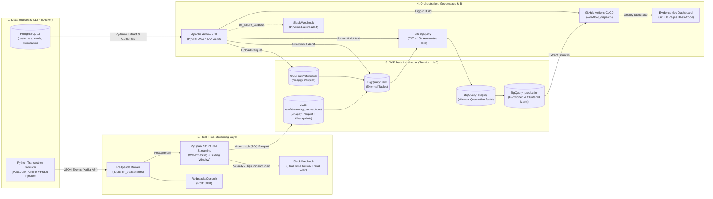
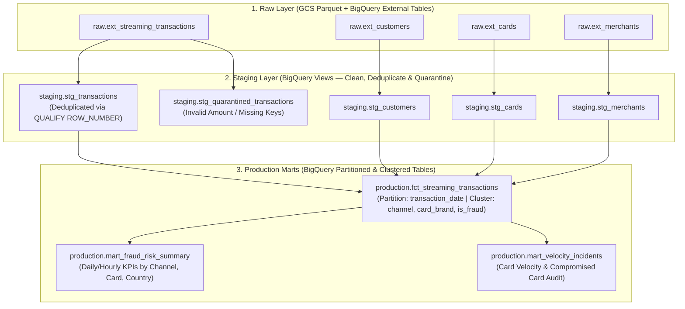

# FinGuard Streaming — System Architecture

## 1. Kiến trúc Tổng thể (High-Level System Architecture)

Hệ thống được thiết kế theo mô hình **Hybrid Streaming & Medallion Lakehouse** kết hợp giữa xử lý luồng thời gian thực (**Real-Time Stream Processing**) và kho dữ liệu phân tích đám mây (**Serverless Cloud Data Warehouse**).

---

## 2. Chi tiết Các Tầng Kiến trúc (Architectural Layers)

### 2.1. Tầng Nguồn Dữ liệu & OLTP (`Sources & OLTP Layer — Direct Producer`)
* **Cơ chế tạo dữ liệu (Self-Hosted Banking & Payment Simulator)**:
  * Sử dụng kết hợp **PL/pgSQL** trong PostgreSQL và **Python Direct Producer (`Faker` + `confluent-kafka`)** để chủ động sinh dữ liệu liên tục với `seed` cố định (đảm bảo tính tái lập 100%, không phụ thuộc API bên ngoài).
* **PostgreSQL (`Reference DB`)**:
  * Đóng vai trò cơ sở dữ liệu giao dịch/tham chiếu gốc lưu trữ 3 bảng cốt lõi được khởi tạo bằng **PL/pgSQL**:
    * `customers`: Thông tin định danh, quốc gia cư trú, phân khúc tín dụng.
    * `cards`: Thông tin thẻ (`card_id`, `customer_id`, `card_brand`, `credit_limit`, `is_active`, `expiry_date`).
    * `merchants`: Danh mục điểm chấp nhận thanh toán (`merchant_id`, `merchant_name`, `mcc_code`, `country`, `risk_level`).
* **Python Transaction Producer (`scripts/transaction_producer.py`)**:
  * Giả lập luồng sự kiện giao dịch tài chính liên tục từ 3 kênh: `POS` (quẹt thẻ tại quầy), `ATM` (rút tiền mặt), và `Online` (thanh toán thương mại điện tử).
  * Tự động bơm các mẫu hành vi gian lận thực tế (**Fraud Patterns**):
    * **Velocity Attack**: Quẹt cùng một `card_id` liên tiếp >= 4 lần trong vòng 1–2 phút.
    * **High-Amount Anomaly**: Giá trị giao dịch đột biến vượt hạn mức hoặc > `$5,000`.
    * **Geo-Location Mismatch**: Giao dịch vật lý (`POS`/`ATM`) phát sinh tại quốc gia khác với quốc gia đăng ký của chủ thẻ.
    * **Blocked / Expired Card Usage**: Giao dịch trên thẻ có `is_active = false`.

---

### 2.2. Tầng Xử lý Luồng Thời gian thực (`Real-Time Streaming Layer`)
* **Redpanda Broker & Console (`Docker`)**:
  * Thay thế Apache Kafka/Zookeeper truyền thống bằng **Redpanda** (viết bằng C++, tương thích 100% Kafka protocol, không cần JVM), tiếp nhận sự kiện vào topic `fin_transactions` với độ trễ mili-giây.
* **PySpark Structured Streaming (`spark/streaming_fraud_processor.py`)**:
  * **Schema Enforcement**: Ép kiểu JSON payload đầu vào bằng `StructType` chặt chẽ.
  * **Stateful Windowing & Watermarking**:
    * Sử dụng `withWatermark("transaction_timestamp", "2 minutes")` kết hợp cửa sổ trượt (`window(col("transaction_timestamp"), "2 minutes", "30 seconds")`) theo `card_id` để đếm tần suất giao dịch và tổng số tiền theo thời gian thực.
  * **Dual Sink Routing**:
    1. **Hot Path (Real-Time Alerting)**: Các giao dịch vi phạm ngưỡng `CRITICAL` (Velocity burst hoặc số tiền cực lớn) được bắn cảnh báo tức thì vào kênh **Slack Fraud Alert**.
    2. **Cold/Warm Path (Lakehouse Sink)**: Ghi micro-batch định kỳ mỗi `30 seconds` dưới định dạng nén **Snappy Parquet** lên **GCS Data Lake** (`gs://<bucket>/raw/streaming_transactions/`) kèm thư mục `checkpoints/` để đảm bảo **Fault-Tolerance** (phục hồi chính xác offset khi khởi động lại).

---

### 2.3. Tầng Kho Dữ liệu Đám mây Medallion (`Cloud Lakehouse & dbt Layer`)

* **Tầng `raw` (GCS + BigQuery External Tables)**:
  * Lưu trữ nguyên bản dữ liệu Parquet từ luồng PySpark Streaming và dữ liệu đồng bộ từ PostgreSQL.
* **Tầng `staging` (dbt Views & Quarantine)**:
  * **Khử trùng lặp (`Deduplication`)**: Do Kafka/Redpanda và Spark Streaming hoạt động theo cơ chế *at-least-once delivery*, model `stg_transactions` sử dụng `QUALIFY ROW_NUMBER() OVER (PARTITION BY transaction_id ORDER BY ingested_at DESC) = 1` để loại bỏ hoàn toàn bản ghi trùng.
  * **Cô lập dữ liệu bẩn (`Quarantine Routing`)**: Các bản ghi có `amount <= 0`, thiếu khóa chính hoặc sai mã tiền tệ được định tuyến sang `stg_quarantined_transactions` kèm lý do lỗi (`quarantine_reason`) thay vì làm gãy pipeline.
* **Tầng `production` (dbt Materialized Tables)**:
  * Tối ưu hóa chi phí truy vấn và hiệu năng trên BigQuery bằng **Time-unit Partitioning** (`transaction_date`) và **Multi-column Clustering** (`transaction_channel`, `card_brand`, `is_fraud`).

---

### 2.4. Tầng Điều phối, Kiểm thử & BI-as-Code (`Orchestration, Quality & BI Layer`)
* **Apache Airflow 2.11 (`airflow/dags/finguard_orchestrator.py`)**:
  * Điều phối quy trình **Hybrid Pipeline**:
    1. Đồng bộ bảng tham chiếu từ PostgreSQL lên GCS Parquet.
    2. Tạo/làm mới BigQuery External Tables cho cả Reference Data và Streaming Parquet.
    3. Thực thi **Data Quality Gate** tại tầng `raw` (kiểm tra số lượng bản ghi và tính toàn vẹn khóa chính).
    4. Chạy `dbt run` và `dbt test` (15+ generic & singular tests).
    5. Kích hoạt GitHub Actions (`workflow_dispatch`) khi toàn bộ kiểm thử đạt 100%.
* **Cơ chế Chịu lỗi & Cảnh báo Vận hành (`Resilience & Observability`)**:
  * **Idempotency**: Mọi bước ghi GCS, tạo bảng BigQuery và chạy `dbt` đều đảm bảo tính lũy đẳng (chạy lại nhiều lần không sinh dữ liệu rác).
  * **Auto-Retry & Slack Incident Alert**: Tự động retry khi gặp lỗi mạng tạm thời; nếu vẫn thất bại sẽ gọi `on_failure_callback` bắn thông báo kèm link log trực tiếp vào Slack.
* **Evidence.dev & GitHub Actions CI/CD**:
  * Báo cáo phân tích rủi ro được viết dưới dạng **Markdown + SQL (`BI-as-Code`)**, tự động trích xuất dữ liệu từ BigQuery `production` marts, đóng gói thành static site và xuất bản lên **GitHub Pages**.

